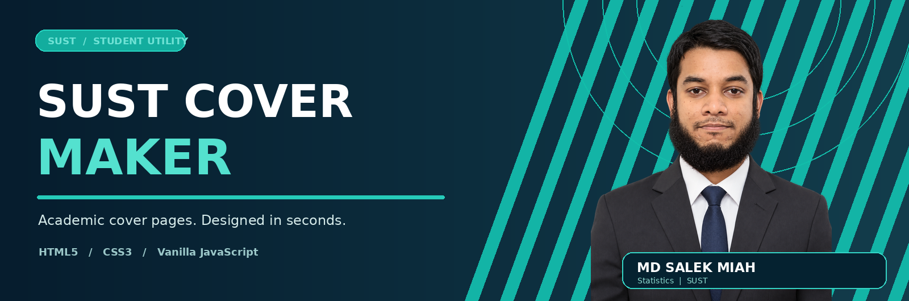
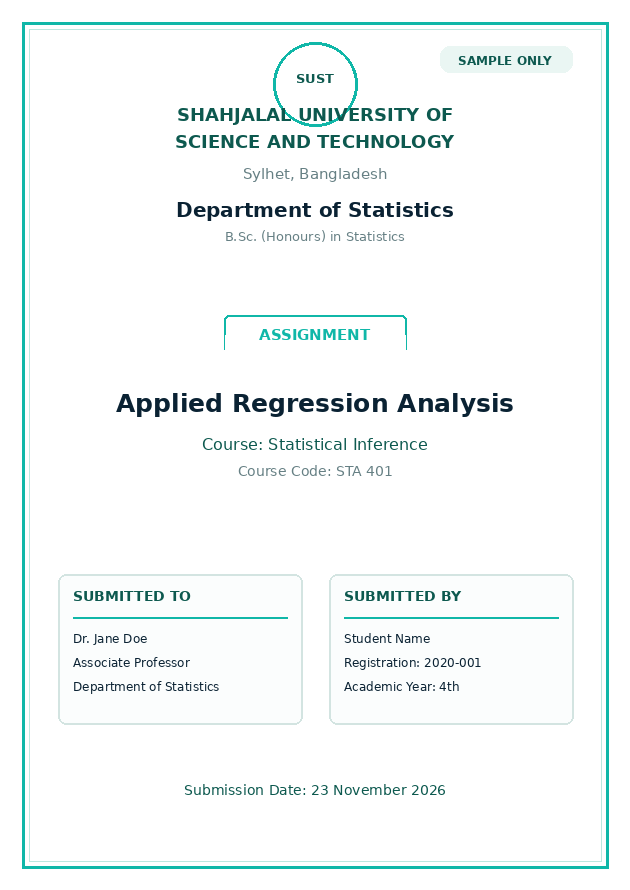
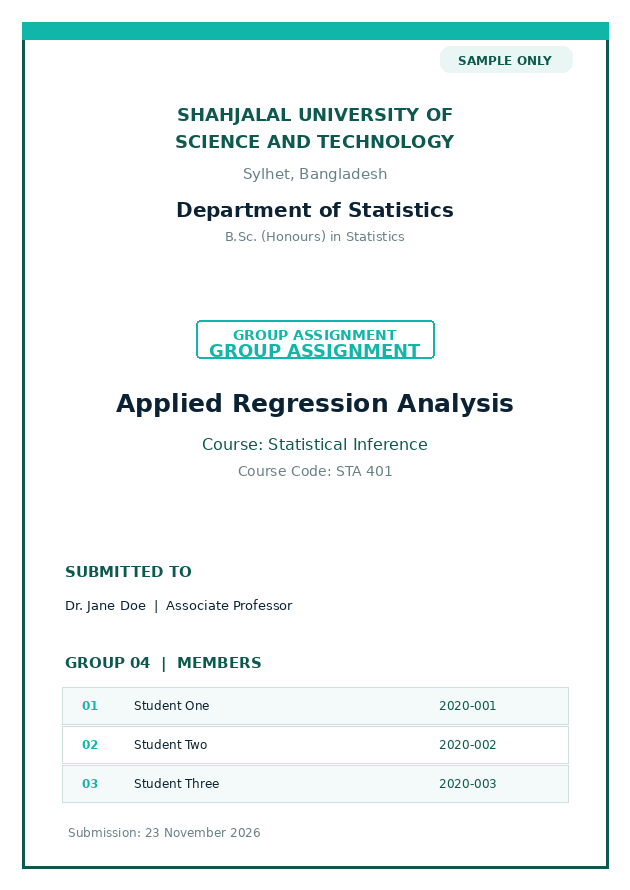

 

 

**A modern, browser-based assignment cover generator for Shahjalal University of Science and Technology (SUST).**

[**Explore the source**](https://github.com/muhammadsalek/sust-cover-maker) · [**Contact the developer**](mailto:saleksta@gmail.com)

---

### Three academic-ready designs

<table>
<tr>
<td align="center" width="33%"> <b>01 · Classic Academic</b></td>
<td align="center" width="33%"> <b>02 · Modern Minimal</b></td>
<td align="center" width="33%"> <b>03 · Group Assignment</b></td>
</tr>
</table>

> **Design previews:** Illustrated examples of the three layouts implemented in `index.html`; they are not screenshots of actual generated PDFs. Sample names and IDs are fictional.

### What it does

| **Create** | **Preview** | **Export** |
|:---|:---|:---|
| Student, course, teacher & group details | Instant, selectable A4 layouts | Client-side PDF & print |
| Required-field validation | Classic, minimal & group templates | No account or database |

### Quick start

**01** Open `index.html` or your deployed site · **02** Enter assignment details · **03** Choose a template & add the official logo · **04** Download PDF or print.

### Technology

`HTML5` · `CSS3` · `Vanilla JavaScript` · `html2canvas` · `jsPDF` · `Vercel`

**Single-page static application.** No React, Node.js, server, build tools or user accounts. PDF libraries load from CDNs; internet access may be needed. Data is processed locally in the browser, with optional local logo storage.

### The developer

<table><tr><td><b>Md Salek Miah</b> B.Sc. (Honours) in Statistics Shahjalal University of Science and Technology Sylhet, Bangladesh  Research interests: <b>Biostatistics · Epidemiology · Population Health · Data Science</b>  <a href="https://github.com/muhammadsalek">GitHub</a> · <a href="mailto:saleksta@gmail.com">Email</a></td></tr></table>

Independently developed student utility; not an official SUST service. University logo should be used with appropriate permission. Always review exported PDFs before academic submission.

 <b>Made for simpler academic workflows · © Md Salek Miah</b>

